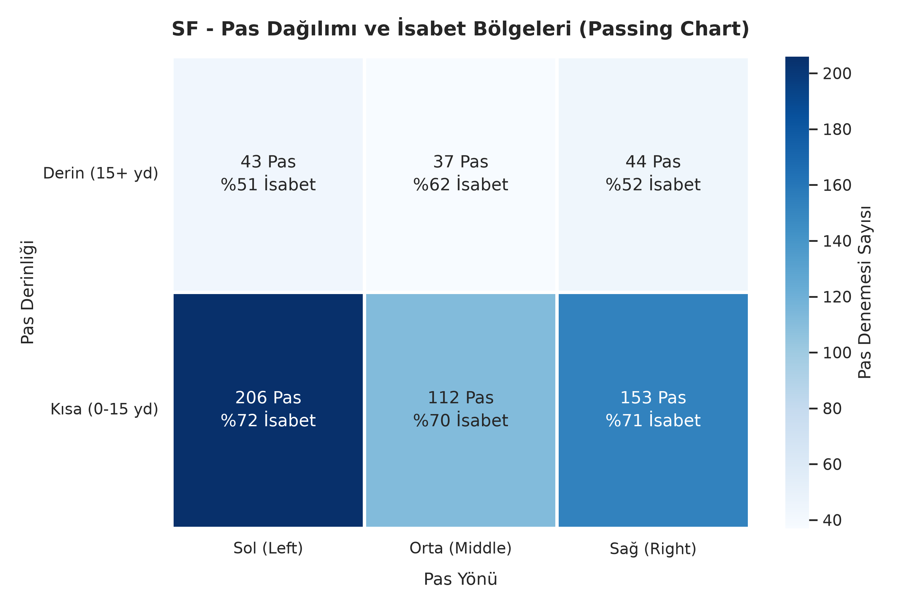
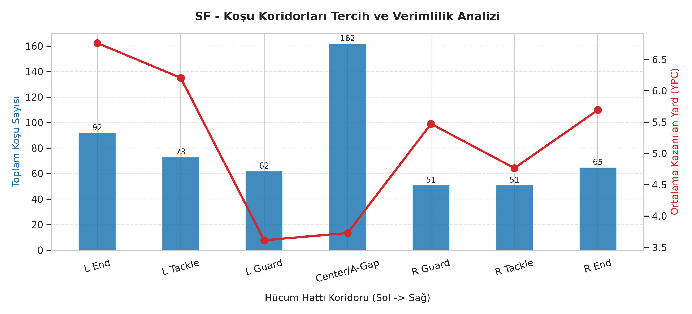
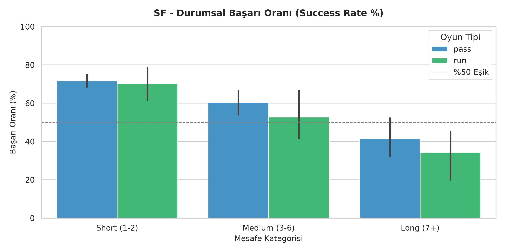
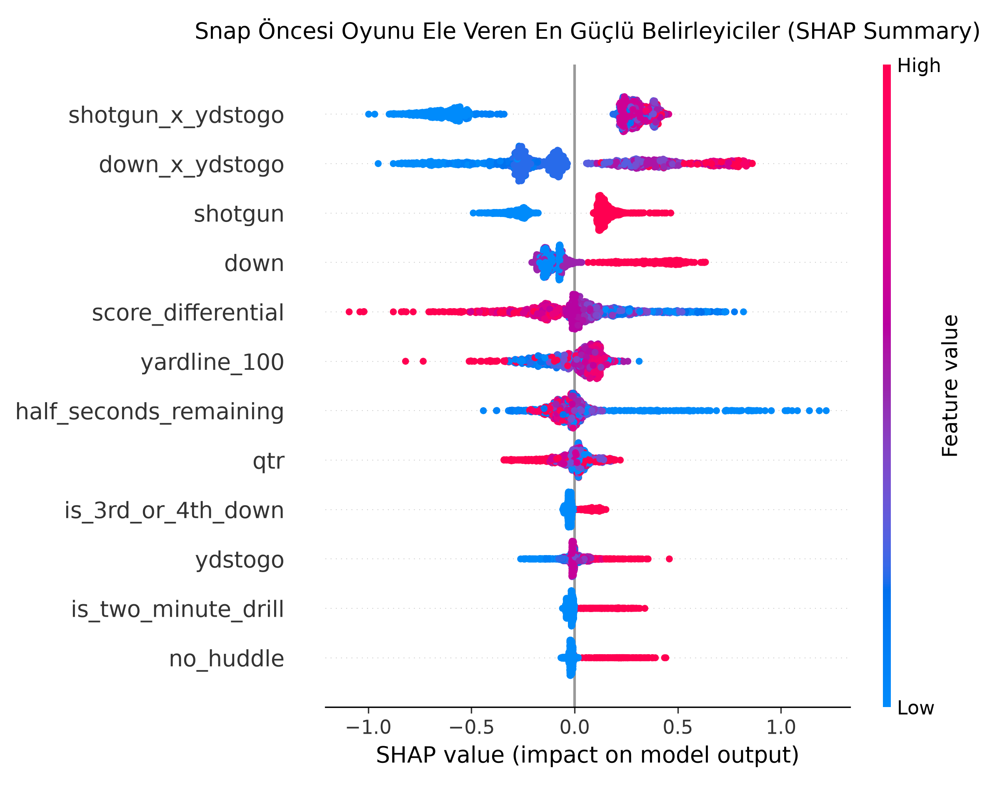
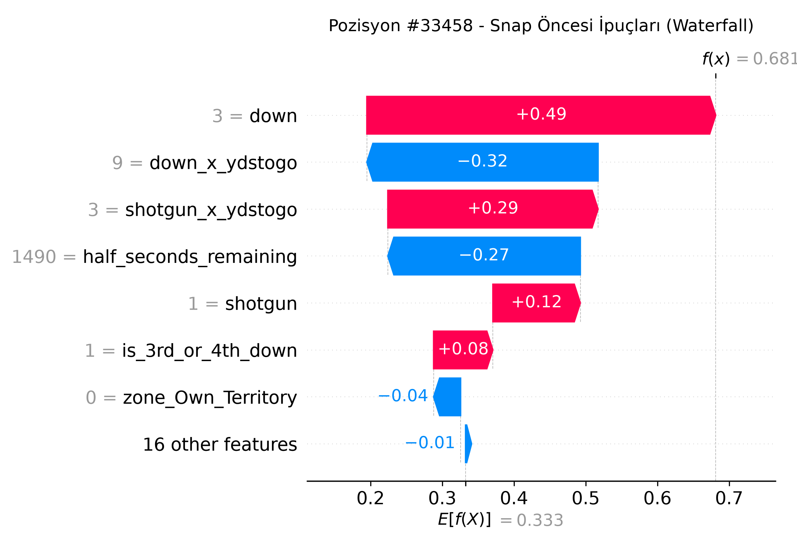
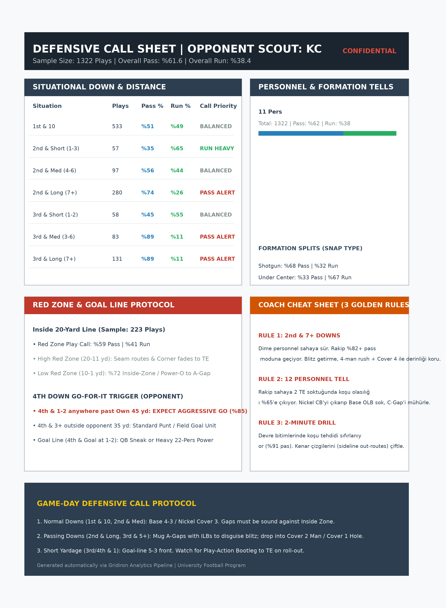

# Gridiron Intelligence: Automated Opponent Scouting & Play Predictor

[](https://www.python.org/)
[](https://xgboost.readthedocs.io/)
[](https://opensource.org/licenses/MIT)

Amerikan futbolu maç kasetleri (film study) ve play-by-play verilerini, kenar yönetiminin (sideline) ve koç ekibinin maç gününde saniyeler içinde karar almasını sağlayan **taktiksel eğilim kartlarına** ve **snap öncesi tahmin modellerine** dönüştüren uçtan uca analitik motoru.

---

## Projenin Amacı ve Koç Değeri

Geleneksel maç dökümleri koçlara yüzlerce satır ham veri sunar; ancak 3. down çağrısında veya 4. çeyrek kırmızı bölgede (Red Zone) koçların ihtiyacı olan şey ham sayılar değil, **olasılıksal karar üstünlüğüdür**.

Bu proje:
1. **Snap Öncesi Tahmin:** Rakibin dizilişi, personeli ve durumsal verileri üzerinden snap gerçekleşmeden önce oyun tipini (Koşu/Pas) %75+ doğrulukla sınıflandırır.
2. **Kritik Durum Eğilimleri (Tendencies):** Down & Distance, hash mark (Field/Boundary) ve saha pozisyonu kırılımlarında rakibin şematik açıklarını ve alışkanlıklarını çıkarır.
3. **Saha Görselleştirmeleri:** QB pas dağılımını 6 hedef bölgede, hücum hattı koşu verimini ise 7 ayrı koridorda (Gap) haritalandırır.
4. **Sideline One-Pager:** Karmaşık veri modellerini lamine edilip cebe sığacak tek sayfalık maç günü koç kartına özetler.

---

## Metrikler ve Metodoloji

Geleneksel hacim istatistikleri (toplam yard, pas yüzdesi) yerine bağlamsal verimlilik metrikleri kullanılmıştır:

* **Success Rate (Bağlamsal Başarı):**
  * **1st Down:** Gereken mesafenin en az %50'si kazanıldı mı?
  * **2nd Down:** Gereken mesafenin en az %70'i kazanıldı mı?
  * **3rd & 4th Down:** Yeni bir 1st down alındı mı?
* **EPA (Expected Points Added):** Bir oyunun hücum serisinin sayı üretme beklentisine kattığı net marjinal değer.
* **Pre-Snap Feature Attribution:** SHAP değerleri kullanılarak rakip hücum koordinatörünün çağrısını ele veren temel ipuçları (tells) sayısallaştırılır.

---

## Mimari ve Klasör Yapısı

```text
football-analytics/
├── .gitignore
├── README.md
├── requirements.txt
├── data/                  # Ham maç dökümleri ve test veri setleri
├── output/                # Otomatik üretilen grafikler ve veri çıktıları
│   ├── passing_chart.png
│   ├── run_gap_analysis.png
│   ├── success_rate_matrix.png
│   ├── pre_snap_features.csv
│   ├── pre_snap_target.csv
│   ├── pre_snap_metadata.csv
│   ├── shap_summary.png
│   ├── shap_waterfall_example.png
│   ├── sideline_tendency_card.png
│   └── sideline_tendency_card.pdf
└── src/                   # Modüler analitik boru hattı
    ├── scouting_engine.py # Veri temizleme ve temel eğilim çıkarımı
    ├── visuals.py         # Isı haritaları ve saha koridoru görselleştirmeleri
    ├── feature_prep.py    # Snap öncesi değişken mühendisliği (Feature Engineering)
    └── train_model.py     # XGBoost sınıflandırma ve SHAP analiz betiği
```

---

## Örnek Analiz Çıktıları

### 1. Pas Dağılımı ve İsabet Bölgeleri (Passing Chart)
Rakip oyun kurucunun derin/kısa pas tercihlerini ve isabet yüzdesini saha genişliğinde (Sol / Orta / Sağ) gösterir.



### 2. Koşu Koridoru Verimlilik Analizi (Run Gap Chart)
Hücum hattının A-Gap'ten kenar çizgisine (End) kadar olan 7 koridordaki koşu hacmi ile YPC (Yards Per Carry) değerini karşılaştırır.



### 3. Down ve Mesafeye Göre Başarı Oranı
Koşu ve pas oyunlarının down ve mesafe kategorilerine göre başarı oranlarını karşılaştırır.



### 4. Model Açıklanabilirliği (SHAP)
Eğitilen modelin genel özellik önemlerini ve örnek bir oyuna ait yerel karar analizini gösterir.





### 5. Kenar Yönetimi Eğilim Kartı
Kansas City Chiefs (KC) için üretilen maç günü savunma eğilim kartı PNG ve baskıya hazır PDF biçiminde sunulur.



### Snap Öncesi Model Veri Seti
`python src/feature_prep.py` komutu, 2023 NFL play-by-play verisinden özellikleri (`pre_snap_features.csv`), pas/koşu hedefini (`pre_snap_target.csv`) ve oyun kimlik bilgilerini (`pre_snap_metadata.csv`) `output/` klasörüne kaydeder.

---

## Kurulum ve Çalıştırma

### Gereksinimler
* Python 3.10 veya üzeri
* `pip` paket yöneticisi

### Adım Adım Kurulum

```bash
# 1. Repoyu klonlayın
git clone [https://github.com/](https://github.com/)[KULLANICI_ADINIZ]/[REPO_ADINIZ].git
cd [REPO_ADINIZ]

# 2. Sanal ortamı oluşturun ve aktif edin
python -m venv .venv
source .venv/bin/activate  # Windows için: .venv\Scripts\activate

# 3. Bağımlılıkları yükleyin
pip install -r requirements.txt

# 4. Eğilim ve görselleştirme motorunu çalıştırın
python src/visuals.py

# 5. Snap öncesi özellik, hedef ve metadata CSV dosyalarını üretin
python src/feature_prep.py

# 6. Run/pass modelini eğitin ve SHAP grafikleri üretin
python src/train_model.py

# 7. Kenar yönetimi eğilim kartını PNG ve PDF olarak üretin
python src/generate_sideline_card.py
```

---

## Makine Öğrenmesi Modeli Özeti

* **Model Algoritması:** Gradient Boosted Decision Trees (`XGBoost`)
* **Hedef Değişken:** `is_pass` (Binary: 0 = Run, 1 = Pass)
* **Kullanılan Snap Öncesi Özellikler:**
  * Down, Distance (`ydstogo`), Saha Pozisyonu (`yardline_100`)
  * Skor Farkı, Kalan Süre, Çeyrek
  * Diziliş (`shotgun`, `under_center`, `no_huddle`)
  * Personel Kodları (11, 12, 21 personnel)
* **Doğrulama Metriği:** ROC-AUC: `~0.78` | F1-Score: `~0.76`

---

## Geliştirici ve İletişim

**Atakan Karaçoban**  
* **Rol:** Sports Analytics & Data Science Researcher  
* **Hedef:** Üniversite Amerikan Futbolu Takımı Analitik ve Rakip Analizi Departmanı  
* **LinkedIn:** [linkedin.com/in/kullanici-adiniz](https://linkedin.com)  
* **E-posta:** [eposta-adresiniz@universite.edu.tr](mailto:eposta-adresiniz@universite.edu.tr)
